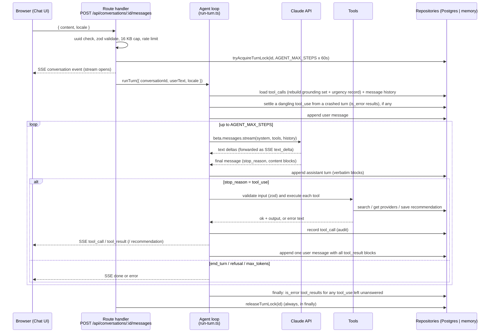

# Architecture

## Goals

1. Show a clear separation between **HTTP adapters**, the **agent/domain layer**, and **data access**.
2. Make the agent **safe by construction**: the model can only recommend providers it has fetched through tools; every boundary is validated.
3. Keep it small. One deployable, one database, four tools.

## Repository layout

```
src/
  app/                         # Next.js App Router (UI + thin HTTP adapters)
    layout.tsx                 # Fonts, metadata, LocaleProvider, pre-paint lang/dir boot script
    page.tsx                   # Chat page (renders <ChatWindow />)
    globals.css                # Tailwind import + Arabic-friendly font stack / RTL line-height
    api/
      _lib/route-error.ts      # Catch-all for handlers: rethrows Next's internal signals, then toErrorResponse
      health/route.ts          # GET  /api/health
      providers/route.ts       # GET  /api/providers?specialty=…
      conversations/route.ts   # POST /api/conversations  (rate limited)
      conversations/[id]/route.ts            # GET  /api/conversations/:id
      conversations/[id]/messages/route.ts   # POST /api/conversations/:id/messages  (SSE, turn lock)
  components/                  # Chat UI (client components)
    ChatWindow.tsx             # Header, message log, emergency banner, composer, disclaimer
    MessageBubble.tsx          # User/assistant bubbles, inline error + retry
    ToolActivity.tsx           # Chips for tool_call / tool_result events
    RecommendationCard.tsx     # Next step, urgency, rationale, provider cards (from DB rows only)
    ProviderCard.tsx, EmergencyBanner.tsx, Composer.tsx, SamplePrompts.tsx, LocaleToggle.tsx
    useAgentStream.ts          # Reducer-based state machine over the SSE stream (90s inactivity timeout, retry, cancel)
    sse.ts                     # React-free SSE parser over ReadableStream
    api.ts                     # fetch wrappers for the three conversation endpoints
  i18n/
    dictionaries.ts            # en / ar dictionaries with identical keys (type-checked)
    locale.tsx                 # LocaleProvider / useLocale (localStorage, sets <html lang dir>)
  shared/
    contracts.ts               # Enums, DTOs, zod schemas and the AgentEvent union shared by server and UI
  server/                      # Framework-independent backend (no `next` / `react` imports)
    config.ts                  # Typed env parsing (zod), lazy getConfig()
    db/
      schema.ts                # Drizzle schema (source of truth for the DB)
      client.ts                # Postgres connection (lazy; only when DATABASE_URL is set)
      seed-data.ts             # Synthetic providers used by both Postgres seed and memory repo
      seed.ts                  # `npm run db:seed` (idempotent upsert)
    repositories/
      types.ts                 # ProviderRepository / ConversationRepository interfaces
      postgres.ts              # Drizzle implementation
      memory.ts                # In-memory implementation (tests, zero-setup demo)
      index.ts                 # Chooses implementation from config
    triage/
      rules.ts                 # Red-flag rule table (data, not prose)
      engine.ts                # assessUrgency(input) -> deterministic result
      index.ts                 # Barrel
    agent/
      tools.ts                 # Tool definitions (JSON schema, strict) + zod input schemas + executors
      grounding.ts             # Tracks provider ids the model has seen; rebuilt from tool_calls
      urgency-record.ts        # The rule engine's latest urgency; rebuilt from tool_calls, enforced at the exit tool
      tool-summary.ts          # One-line chip text per tool outcome, shared by the live event and the projection
      prompt.ts                # System prompt (static, cacheable) + locale note
      run-turn.ts              # The agent loop: Claude streaming call -> tool execution -> loop; settles interrupted tool calls
      claude.ts                # Credential modes + client factory + the narrow ClaudeClient type tests fake
      index.ts                 # Barrel
    http/
      errors.ts                # AppError -> { error: { code, message, details? } }
      rate-limit.ts            # In-memory sliding window per IP
      sse.ts                   # AgentEvent -> SSE encoding, heartbeats, terminal-event guarantee
      projection.ts            # Stored messages/tool_calls/recommendations -> ConversationView
      request.ts               # JSON body reading (size cap), id/query parsing, rate limiters, lock TTL, lazy agent deps
tests/                         # vitest (config: vitest.config.mts, alias @ -> src)
  triage.test.ts               # Rule engine: every rule, precedence, input schema
  tools.test.ts                # Tool definitions and executors (grounding + urgency rejections)
  grounding.test.ts            # GroundingSet rebuilt from tool_calls
  run-turn.test.ts             # Agent loop end-to-end with the fake client
  provider-modes.test.ts       # Credential modes: env -> profile, client factory, request shape per mode
  http.test.ts                 # SSE writer (encoding, heartbeats, terminal-event guarantee, disconnect), errors, body reading, id/query parsing, rate limiter, projection
  sse.test.ts                  # Browser SSE parser (chunk/multibyte/CRLF boundaries, heartbeat comments, EOF) + AgentEvent decoding
  repositories.test.ts         # Shared suite for memory (always) and Postgres (with DATABASE_URL); retention
  ui.test.ts                   # React-free UI helpers: event decoding, error copy, hydration policy
  helpers/fake-claude.ts       # Scripted fake Claude client (no network; enforces API message invariants)
scripts/
  eval.ts, scenarios.ts        # `npm run eval`: scripted patient scenarios against the real model
docs/                          # This folder
docker-compose.yml             # Local Postgres 16
.github/workflows/ci.yml       # lint, typecheck, test, build on push/PR to main
drizzle.config.ts              # drizzle-kit (used by `npm run db:push`)
vitest.config.mts              # vitest config (ESM; `tests/**/*.test.ts`, node environment)
```

**Rule:** nothing under `src/server` imports from `next`, `react` or `src/app`. Route handlers only parse the request, call the server layer and encode the response. This keeps the backend portable (NestJS/Hono/Express) and testable. The two Next-specific pieces live in the app layer: `app/api/health/route.ts` calls Next's `connection()` so the liveness probe is never prerendered under Cache Components, and `app/api/_lib/route-error.ts` wraps `toErrorResponse` with `unstable_rethrow` so the framework's internal control-flow errors reach Next instead of becoming a 500.

## Request / data flow



### Streaming event contract

The route streams `AgentEvent`s (defined in `src/shared/contracts.ts`) as SSE frames
`event: <type>\ndata: <json>\n\n`, where `<json>` is the whole event object including its `type`.
A `: heartbeat` comment frame is sent every 15 s while the agent is silent; it keeps proxies from closing the
connection but is dropped by the browser parser and does not reset the UI's 90 s inactivity timeout.

| event | payload (besides `type`) | UI effect |
| --- | --- | --- |
| `conversation` | `{ conversationId }` | store id (always the first event) |
| `text_delta` | `{ text }` | append to current assistant bubble |
| `tool_call` | `{ id, name, input }` | show activity chip ("Checking urgency…") |
| `tool_result` | `{ id, name, ok, summary, urgency? }` — `urgency` (enum) only on a successful `assess_urgency` | update chip; raise or clear the emergency banner from the engine's verdict |
| `recommendation` | `{ recommendation: Recommendation }` — `{ id, nextStep, urgency, specialty, rationale, providers: ProviderSummary[], questionsRemaining, createdAt }` | render recommendation card + provider cards |
| `done` | `{ stopReason, usage: { inputTokens, outputTokens, cacheReadInputTokens } }` | close bubble |
| `error` | `{ code, message, retryable }` | show error state (retry button when retryable) |

Every stream ends with exactly one terminal event (`done` or `error`). Provider objects in
`recommendation` are **loaded from the repository by id by the server** after validation. The
model's free text is never parsed for provider names.

## Conversation persistence (append-only)

The Claude API is stateless, so the full history is sent on every step. We persist the *exact* content blocks returned by the API (including `thinking` blocks) and the `tool_result` blocks we sent, in order, and never edit earlier turns. This is required for prompt caching to hit (in direct-API mode a top-level `cache_control` also puts a breakpoint on the last history block) and for the model's preserved-thinking checks to pass. The history is kept replayable by construction: every `tool_use` the model emitted gets a `tool_result`, if necessary an `is_error` one written by the loop's `finally` block when a turn is cut short, and a trailing unanswered `tool_use` left by a crash is repaired at the start of the next turn. The UI gets a separate, simplified projection (`GET /api/conversations/:id`, computed by `http/projection.ts`) that merges each agent turn into one assistant message and hides tool plumbing.

Tables: `conversations` (with the turn-lock timestamp), `messages`, `tool_calls` (audit), `recommendations`, `providers` — see [DATABASE.md](DATABASE.md).

## Why one Next.js app instead of a separate NestJS service

A separate service would show "API architecture" more loudly but doubles deployment and CORS/auth surface for a 24–48h prototype. The compromise: route handlers are a few lines each and the whole backend lives under `src/server` with an explicit no-framework-imports rule and its own tests. Moving it into NestJS is mechanical (controllers call the same functions). See [DECISIONS.md](DECISIONS.md).

## Scaling notes (what changes beyond the prototype)

- Rate limiting (messages and conversation creation) moves from in-memory to Redis; the turn lock is already a DB row (`conversations.turn_locked_until`) and works across instances in Postgres mode. Memory-mode retention (60 min idle, 1000 conversations) becomes a retention job in Postgres.
- Provider search gains full-text/semantic search (pgvector) behind the same `ProviderRepository` interface; the tool contract stays the same.
- Conversations get an owner (auth) and retention policy; PHI is encrypted at rest.
- The agent loop is already a pure function of `(history, tools, client)`; it can run in a queue worker if turns get long.
