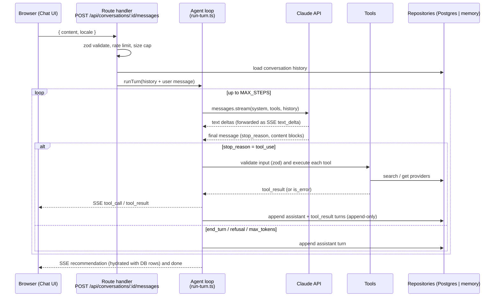

# Architecture

## Goals

1. Show a clear separation between **HTTP adapters**, the **agent/domain layer**, and **data access**.
2. Make the agent **safe by construction**: the model can only recommend providers it has fetched through tools; every boundary is validated.
3. Keep it small. One deployable, one database, ~four tools.

## Repository layout

```
src/
  app/                         # Next.js App Router (UI + thin HTTP adapters)
    page.tsx                   # Chat page
    api/
      health/route.ts          # GET  /api/health
      providers/route.ts       # GET  /api/providers?specialty=…
      conversations/route.ts   # POST /api/conversations
      conversations/[id]/route.ts            # GET  /api/conversations/:id
      conversations/[id]/messages/route.ts   # POST /api/conversations/:id/messages  (SSE)
  components/                  # Chat UI (client components)
  i18n/                        # en / ar dictionaries + direction helpers
  shared/
    contracts.ts               # Enums, DTOs, zod schemas and the AgentEvent union shared by server and UI
  server/                      # Framework-independent backend (no `next` imports)
    config.ts                  # Typed env parsing (zod)
    db/
      schema.ts                # Drizzle schema (source of truth for the DB)
      client.ts                # Postgres connection (lazy; only when DATABASE_URL is set)
      seed-data.ts             # Synthetic providers used by both Postgres seed and memory repo
      seed.ts                  # `npm run db:seed`
    repositories/
      types.ts                 # ProviderRepository / ConversationRepository interfaces
      postgres.ts              # Drizzle implementation
      memory.ts                # In-memory implementation (tests, zero-setup demo)
      index.ts                 # Chooses implementation from config
    triage/
      rules.ts                 # Red-flag rule table (data, not prose)
      engine.ts                # assessUrgency(input) -> deterministic result
    agent/
      tools.ts                 # Tool definitions (JSON schema, strict) + zod input schemas + executors
      grounding.ts             # Tracks provider ids the model has seen; validates recommendations
      prompt.ts                # System prompt (static, cacheable) + locale instruction
      run-turn.ts              # The agent loop: Claude streaming call -> tool execution -> loop
      claude.ts                # Anthropic client factory (injectable for tests)
    http/
      errors.ts                # AppError -> { error: { code, message } }
      rate-limit.ts            # In-memory sliding window per IP
      sse.ts                   # AgentEvent -> SSE encoding
tests/                         # vitest
scripts/eval.ts                # Scripted patient scenarios against the real model
docs/                          # This folder
```

**Rule:** nothing under `src/server` imports from `next`, `react` or `src/app`. Route handlers only parse the request, call the server layer and encode the response. This keeps the backend portable (NestJS/Hono/Express) and testable.

## Request / data flow



### Streaming event contract

The route streams `AgentEvent`s (defined in `src/shared/contracts.ts`) as SSE lines `event: <type>\ndata: <json>\n\n`:

| event | payload | UI effect |
| --- | --- | --- |
| `conversation` | `{ conversationId }` | store id |
| `text_delta` | `{ text }` | append to current assistant bubble |
| `tool_call` | `{ id, name, input }` | show activity chip ("Checking urgency…") |
| `tool_result` | `{ id, name, ok, summary }` | update chip |
| `recommendation` | `{ nextStep, urgency, rationale, providers: ProviderDto[] , questionsRemaining }` | render recommendation card + provider cards |
| `done` | `{ stopReason, usage }` | close bubble |
| `error` | `{ code, message, retryable }` | show error state |

Provider objects in `recommendation` are **loaded from the repository by id by the server** after validation. The model's free text is never parsed for provider names.

## Conversation persistence (append-only)

The Claude API is stateless, so the full history is sent on every step. We persist the *exact* content blocks returned by the API (including `thinking` blocks) and the `tool_result` blocks we sent, in order, and never edit earlier turns. This is required for prompt caching to hit and for the model's preserved-thinking checks to pass. The UI gets a separate, simplified projection (`GET /api/conversations/:id`) that hides tool plumbing.

Tables: `conversations`, `messages`, `tool_calls` (audit), `recommendations`, `providers` — see [DATABASE.md](DATABASE.md).

## Why one Next.js app instead of a separate NestJS service

A separate service would show "API architecture" more loudly but doubles deployment and CORS/auth surface for a 24–48h prototype. The compromise: route handlers are two-line adapters and the whole backend lives under `src/server` with an explicit no-framework-imports rule and its own tests. Moving it into NestJS is mechanical (controllers call the same functions). See [DECISIONS.md](DECISIONS.md).

## Scaling notes (what changes beyond the prototype)

- Rate limiting and conversation locking move from in-memory to Redis.
- Provider search gains full-text/semantic search (pgvector) behind the same `ProviderRepository` interface; the tool contract stays the same.
- Conversations get an owner (auth) and retention policy; PHI is encrypted at rest.
- The agent loop is already a pure function of `(history, tools, client)`; it can run in a queue worker if turns get long.
