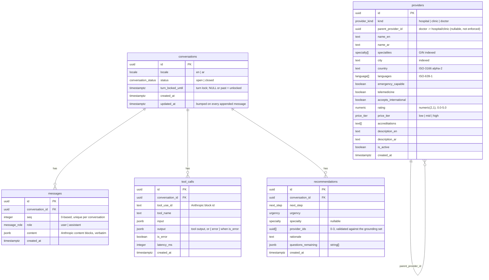

# Database

PostgreSQL via Drizzle ORM. The schema in `src/server/db/schema.ts` is the source of truth; `npm run db:push` applies it (`drizzle-kit push`, no migration files), `npm run db:seed` loads synthetic data with an idempotent upsert. When `DATABASE_URL` is unset the same seed data backs an in-memory repository with identical behaviour (`tests/repositories.test.ts` runs the same suite against both).

Enumerated columns are real Postgres enums (`provider_kind`, `specialty`, `language`, `price_tier`, `urgency`, `next_step`) whose values come from the constants in `src/shared/contracts.ts`, so the DB, the zod schemas and the tool JSON schemas can never disagree. `locale`, `conversation_status` and `message_role` are small enums declared in the schema file.

## Notes

- `messages.content` stores the API content blocks **verbatim** (including `thinking` and `tool_use` / `tool_result` blocks) so history can be replayed byte-identically. `seq` is assigned by the repository (atomically via a subselect in Postgres; the unique index catches races). The UI projection is computed from these rows, never stored separately.
- `tool_calls` is the audit trail and the source for rebuilding the **grounding set** (provider ids the model has seen) on each turn.
- `recommendations.provider_ids` are validated against the grounding set before insert — a recommendation row can only reference providers the model fetched. Rows are hydrated with provider summaries (in the stored order) when read.
- `conversations.turn_locked_until` implements the one-turn-per-conversation lock with a single atomic `UPDATE … WHERE turn_locked_until IS NULL OR turn_locked_until < now() RETURNING id`; the TTL (120 s) frees a lock left behind by a crashed turn. The memory repository mirrors the same semantics.
- All child tables cascade on conversation delete.
- Provider search: `is_active = true`, `specialties @> ARRAY[$1]` (array containment, served by the GIN index), `lower(city) = lower($2)`, `country`, `languages @> ARRAY[$3]`, the two boolean flags, `ORDER BY rating DESC, name_en ASC LIMIT n`; `total` is a `count(*)` with the same `WHERE`.
- Indexes: `providers (city)`, GIN on `providers (specialties)`, unique `messages (conversation_id, seq)`, `tool_calls (conversation_id)`, `recommendations (conversation_id)`.
- Connection: lazy `postgres` driver singleton (`max: 5`, `prepare: false` for pooler compatibility) created only when `DATABASE_URL` is set.
- Seed (`src/server/db/seed-data.ts`): 33 fictional providers — 10 hospitals, 7 clinics and 16 doctors, each doctor attached to a facility in the same city — across Istanbul, Ankara, Antalya, Dubai, Riyadh, Amman, Cairo, Berlin and London (TR, AE, SA, JO, EG, DE, GB). All 14 specialties are covered (incl. pulmonology and endocrinology); languages mix en/ar/tr/de/fr; 9 providers are emergency-capable, 7 doctors offer telemedicine, and exactly one doctor is `is_active = false` to exercise the exclusion path. Ids are hard-coded v4 UUIDs so recommendations stay stable across re-seeds. Names, ratings (3.9–4.9) and accreditations are invented.
