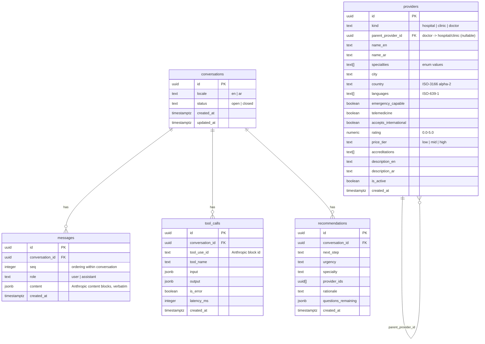

# Database

PostgreSQL via Drizzle ORM. The schema in `src/server/db/schema.ts` is the source of truth; `npm run db:push` applies it, `npm run db:seed` loads synthetic data. When `DATABASE_URL` is unset the same seed data backs an in-memory repository with identical behaviour.

## Notes

- `messages.content` stores the API content blocks **verbatim** (including `thinking` and `tool_use` / `tool_result` blocks) so history can be replayed byte-identically. The UI projection is computed from these, never stored separately.
- `tool_calls` is the audit trail and the source for rebuilding the **grounding set** (provider ids the model has seen) on each turn.
- `recommendations.provider_ids` are validated against the grounding set before insert — a recommendation row can only reference providers the model fetched.
- Enumerations (`kind`, specialties, `price_tier`, `urgency`, `next_step`) are declared once in `src/shared/contracts.ts` and used for the Drizzle columns, the zod schemas and the tool JSON schemas.
- Indexes: `providers (city)`, GIN on `providers (specialties)`, `messages (conversation_id, seq)`, `tool_calls (conversation_id)`.
- Seed: ~30 providers across Istanbul, Ankara, Antalya, Dubai, Riyadh, Amman, Cairo, Berlin and London, covering cardiology, neurology, orthopedics, oncology, dermatology, gastroenterology, general practice, emergency medicine, pediatrics, psychiatry, ophthalmology and dentistry, with mixed languages (en/ar/tr/de) and a few telemedicine-only doctors. Names are fictional.
